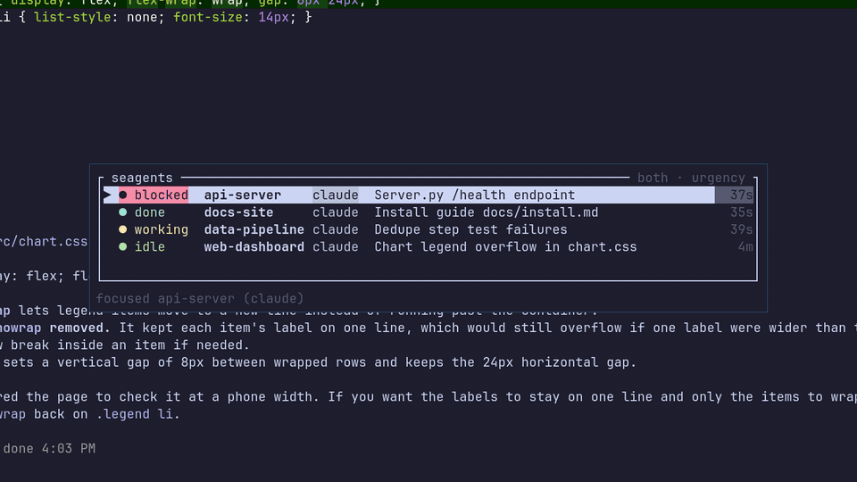
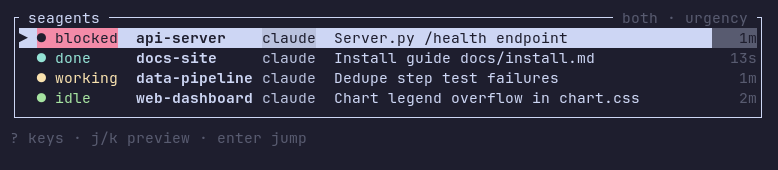

# seagents: coding agents as i3 windows

**See your coding agents.** seagents runs Claude Code and Codex in
[herdr](https://github.com/ogulcancelik/herdr) and shows each one in its own
i3 window, so you can tell at a glance which agent is blocked and waiting on
you, and jump straight to it.

- **One window per agent.** `seagents run claude` starts the agent in a herdr
  server and turns the current terminal into a full-window view of it.
  Closing the window stops the agent.
- **HUD.** A small floating panel lists every agent as blocked, done,
  working or idle, most urgent first. It previews an agent's window as you
  move through the list and jumps to it on Enter.
- **Focus.** `seagents focus <tag>` raises an agent's window from a script or
  a keybinding.
- **Reboot survival.** The window layout is captured continuously.
  `seagents restore` rebuilds it after a reboot, and each window resumes its
  own conversation.
- **Orchestration.** Agents can start other agents and drive them:
  `spawn` / `wait` / `send` / `read` / `stop`, each printing JSON.
- **Remote access through herdr.** The agents live in herdr, so
  `herdr --remote ssh <host>` from another machine shows the same agents and
  drives them, while the i3 windows keep showing them.



## Why

If you live in i3, your muscle memory is already in your i3 keybindings:
focus, move, split, workspaces. Terminal multiplexers built for coding agents
(tmux, herdr) put every agent in a pane or tab inside one terminal, with their
own layouts and their own keys — a second window manager inside the first.
seagents keeps i3 in charge: every agent is a real i3 window, driven with the
keys you already tuned.

One terminal window per agent has its own problems once you run more than a
couple, and seagents covers those too:

- **Agents wait on you without telling you.** One stops at a permission
  prompt, another finished ten minutes ago, and you only find out when you
  happen to visit their workspace. The HUD shows which one needs you.
- **A terminal window is stuck on its machine.** Agents started in plain
  windows on the laptop can't be checked or answered from the desktop.
  Through herdr, they can.
- **A reboot loses the arrangement.** Which conversation was in which window,
  on which workspace, in which directory. `seagents restore` brings it back.
- **Agents can't hand work to agents you can see.** Delegating to a
  background subprocess hides the work; `seagents spawn` opens it in a window
  you can watch, and the first agent can still wait for it and read its
  answer.

herdr does the hard parts underneath: it owns the agents' terminals, knows
whether each one is working, blocked or done, and serves them to other
machines. seagents is the i3 side of it.

## Requirements

- Linux with X11 **i3**. It is not tested on sway or Wayland.
- **herdr ≥ 0.9.0**, on `PATH` or at `~/.local/bin/herdr`. seagents starts a
  herdr server if none is running.
- A terminal emulator. **Terminator**, **alacritty** and **alacritty in
  daemon mode** (`alacritty --daemon`) have built-in launch recipes, used by
  `spawn` and `restore`. For any other terminal, set `SEAGENTS_TERMINAL_CMD`
  (a template over `{handle}`, `{cwd}`, `{cmd}`) and
  `SEAGENTS_TERMINAL_MATCH` (`role`, `instance` or `class`).
- **Claude Code** and/or **Codex**. Other agents herdr knows can be started
  too, but only these two report their turns, so the other agents' state
  comes from the screen alone.
- Optional: **xdotool**. On a terminal that runs one process per window but
  doesn't report its window id in the environment, it lets seagents identify
  an agent's window exactly.
- A Rust toolchain to build.

## Install

From a checkout:

```sh
cargo build --release
install -Dm755 target/release/seagents ~/.local/bin/seagents
```

`~/.local/bin` has to be on your `PATH`.

## Quick start

Start an agent from any terminal in i3:

```sh
seagents run claude            # or: seagents run codex
```

Everything after the agent's name goes to the agent unchanged
(`seagents run claude --model opus`). To track every agent without
thinking about it, alias the command:

```sh
alias claude='seagents run claude'
```

The alias also works inside herdr's own panes. There `seagents run` just runs
the agent, so herdr still finds it in its pane.

In an agent's window, **Ctrl+B is herdr's attach prefix**. Press Ctrl+B
Ctrl+B to send a single Ctrl+B to the agent. A detach (Ctrl+B q) is undone
at once.

`seagents status` prints the same information as the HUD as a table, or as
JSON with `--json`.

## The HUD



`seagents hud` (or plain `seagents`) opens the panel. Bind it to a key and
float it in `~/.config/i3/config`. The HUD's window must carry the role or
instance `seagents-hud`. With alacritty:

```conf
bindsym $mod+o exec --no-startup-id alacritty --class seagents-hud -e seagents hud
for_window [instance="^seagents-hud$"] floating enable, sticky enable, border pixel 1, resize set 480 340, move position center
```

With Terminator:

```conf
bindsym $mod+o exec --no-startup-id terminator --role=seagents-hud -e "seagents hud"
for_window [window_role="seagents-hud"] floating enable, sticky enable, border pixel 1, resize set 480 340, move position center
```

A comma in an i3 `exec` line separates i3 commands, so quote the whole
command if it contains a comma (for example `--class Alacritty,seagents-hud`).

| key | action |
|---|---|
| `j` / `k`, arrows, mouse wheel | move through the list and preview the agent's window, keeping focus on the HUD |
| `g` / `G` | first / last row |
| `Enter`, left click | jump to the agent's window |
| `p` | send the selected agent a prompt (Enter sends, Esc cancels) |
| `x` | stop the selected agent (asks y/n) |
| `s` | cycle the sort: urgency → directory → recent |
| `t` | cycle the name columns: directory + title → title → directory |
| `r` | refresh now |
| `?` | show every key |
| `q`, `Esc` | quit |

The HUD remembers the sort and column choices between launches.

## After a reboot

```sh
seagents restore --dry-run     # show what would come back
seagents restore               # rebuild the layout, each agent on its own conversation
```

`seagents snapshot` captures the layout on demand. You rarely need it,
because every running agent, the HUD and `status` also capture it, at most
once every 30 s. Use `--workspace NAME` to restore only one workspace, and
`--stagger SECS` to set the delay between window launches.

`restore` reproduces the layout exactly only when no agents are running, as
after a reboot. Don't switch workspaces while it runs: new windows land on
the focused workspace.

## Orchestration

Agents and scripts can start and drive other agents. Each command prints
JSON on stdout and returns a meaningful exit code:

```sh
seagents spawn --tag review --prompt-file seed.md     # new window, new agent; --agent codex for Codex
seagents wait review --after 0 --timeout 100s          # the turn's outcome, with its last_message
seagents send review "Also check the refresh path."    # a follow-up turn
seagents read review --tail 20                         # the conversation so far
seagents stop review
```

`seagents <command> --help` documents every flag, JSON shape and exit code.
[`skills/seagents-orchestrate/SKILL.md`](skills/seagents-orchestrate/SKILL.md)
is a Claude Code skill that teaches an agent this loop: when to spawn, how
to write the seed prompt, and what each `wait` outcome means. To make it
available to Claude Code, link it into your skills directory, so it stays in
step with the checkout:

```sh
ln -s "$PWD/skills/seagents-orchestrate" "${CLAUDE_CONFIG_DIR:-$HOME/.claude}/skills/seagents-orchestrate"
```

## Limitations

- **i3 and Linux only.** Windows are found and focused through `i3-msg`, and
  processes through `/proc`.
- **Agents run under the herdr server's environment, not your shell's.**
  `FOO=bar seagents run claude` does not reach Claude. Start the herdr server
  from the environment you want the agents to have, or let seagents start it.
- **herdr starts an agent by typing its command into a shell in the pane.**
  Your shell's rc files and aliases apply, and the command appears in the
  shell's history. herdr refuses agent arguments that contain control
  characters, such as a newline.
- **Text goes to herdr as one command-line argument.** `send` keeps it
  under 128 KiB, and a text that is exactly `--session`, or starts with
  `--session=`, is taken by herdr as its own option. Long or multi-line
  prompts are written to a file in the agent's directory (`.seagents/prompts/`)
  and sent by reference.
- A new agent's window shows `starting <tag>…` for a few seconds while herdr
  starts it.
- Several agents in tabs of one Terminator window can't be focused
  individually. Use separate windows.

## Documentation

- [`docs/HANDOFF.md`](docs/HANDOFF.md) is the full design and implementation
  reference: architecture, data model, every command, and the gotchas.
- [`docs/HERDR-BACKEND-SPEC.md`](docs/HERDR-BACKEND-SPEC.md) explains why the
  agents run in herdr, and the decisions behind it.

## License

Apache-2.0. See [`LICENSE`](LICENSE).
